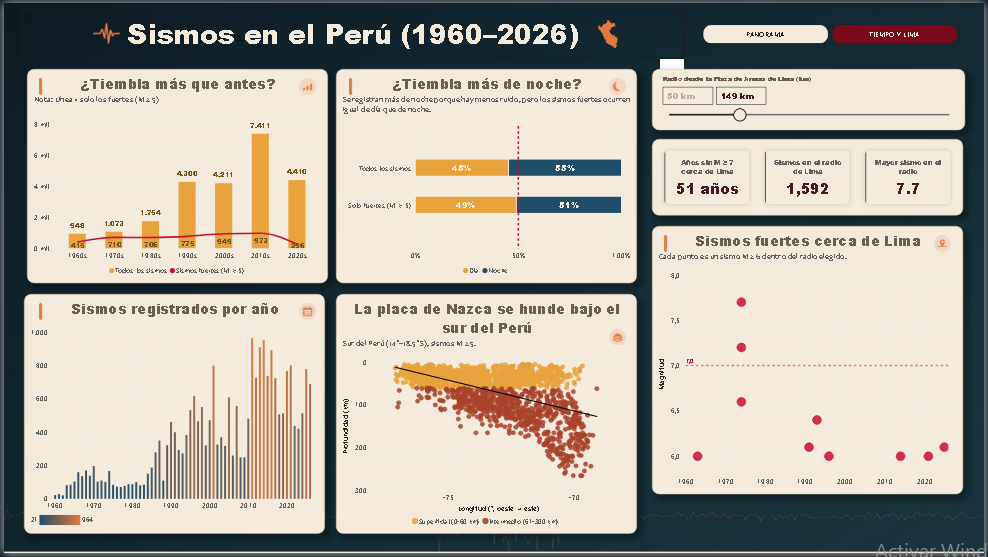
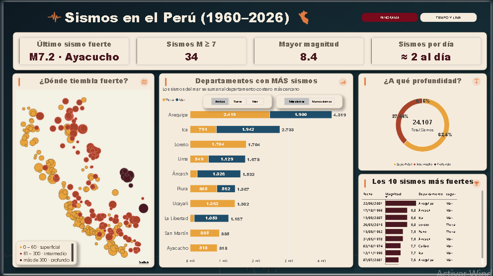

# Sismos en el Perú (1960–2026) (Python + Power BI)

> **¿Tiembla más que antes en el Perú?** Los datos dicen que no: lo que aumentó fue la capacidad de detectar sismos.

Proyecto de análisis de datos con el catálogo sísmico instrumental del Instituto Geofísico del Perú (IGP)





## Preguntas que responde
1. ¿Dónde tiembla más y con qué fuerza?
2. ¿A qué profundidad ocurren los sismos?
3. ¿Tiembla más que antes?
4. ¿Tiembla más de noche que de día?
5. ¿Qué tan expuesta está Lima a un sismo fuerte?


## Datos
| | |
|---|---|
| **Fuente** | Centro Sismológico Nacional (CENSIS) – IGP · [ultimosismo.igp.gob.pe](https://ultimosismo.igp.gob.pe/repositorio/datos-sismicos) |
| **Periodo** | 13/01/1960 – 11/10/2026 |
| **Registros** | 25,797 sismos (24,107 dentro del Perú o su mar) |
| **Columnas originales** | fecha UTC, hora UTC, latitud, longitud, profundidad (km), magnitud |
| **Mapa de departamentos** | [peru-geojson](https://github.com/juaneladio/peru-geojson) (licencia MPL 2.0, ver `mapas/`) |


## ETL en Python (`Limpieza_sismos_IGP_2026.ipynb`)

**Problemas encontrados y cómo se resolvieron**

| # | Problema | Cómo se detectó | Decisión |
|---|---|---|---|
| 1 | Nombres de columnas con espacios y símbolos | `df.columns` | Renombrar a mayúsculas simples |
| 2 | Fecha y hora como texto | `df.info()` | Convertir a fecha real (`to_datetime`) |
| 3 | Hora en dos formatos (con y sin `.00`) y 3 con espacio final | Largo del texto de la hora | `strip()` + primeros 8 caracteres |
| 4 | Fechas en UTC | Diccionario del IGP | Restar 5 horas (hora del Perú) |
| 5 | Sin columna ID | `df.columns` | Crear ID consecutivo tras ordenar |
| 6 | Sesgo de detección | Magnitud más frecuente por época | Columnas `MC_PERIODO`, `SOBRE_MC` y `COMPARABLE_1960_2026` |
| 7 | Sin nombre de lugar | Solo hay coordenadas | GeoJSON → `DEPARTAMENTO` y `UBICACION` |
| 8 | Sismos en el mar o fuera del Perú | No caen en ningún departamento | Regla de costa y fronteras |

Se verificó además que no hay duplicados, filas desordenadas, huecos recientes ni profundidades de 0 km.

**Variables creadas:** año, mes, día, hora, década, tipo de profundidad (según H. Tavera, IGP), rango de magnitud, distancia a Lima y distancia a la costa (fórmula de Haversine).

**Resultado:** `sismos_limpio.csv` · 25,797 filas · 21 columnas · 0 vacíos · 0 duplicados.

## Dashboard en Power BI (`Dashboard_Sismos_Perú.pbix`)

**Página 1 · Panorama**
- Tarjetas: último sismo fuerte, sismos M ≥ 7, mayor magnitud, sismos registrados por día
- Mapa de sismos fuertes por profundidad
- Departamentos con más sismos (Tierra vs Mar)
- Distribución por profundidad y Top 10 sismos más fuertes

**Página 2 · Tiempo y Lima**
- ¿Tiembla más que antes? (todos los sismos vs M ≥ 5 por década)
- ¿Tiembla más de noche?
- Sismos registrados por año
- La placa de Nazca se hunde bajo el sur del Perú (profundidad vs longitud)
- Sismos fuertes cerca de Lima con **radio ajustable** (50–450 km)


## 🔍 Hallazgos principales
1. **No tiembla más que antes, se detecta más.** Los sismos menores a M5 pasan de 383 (años 70) a 6,916 (años 2010) por década, pero los M ≥ 5 se mantienen estables (743 a 1,047).
2. **Arequipa es el departamento con más sismos (4,319)**; en Ica la mayoría ocurren en el mar.
3. **El 62 % de los sismos son superficiales** (0–60 km), los más peligrosos.
4. **Los sismos fuertes ocurren a cualquier hora:** 49 % de día y 51 % de noche (M ≥ 5).
5. **Lima lleva 51 años sin un sismo M ≥ 7 a menos de 150 km** (el último fue en 1974, M7.7). Según el IGP, la costa central acumula energía desde el terremoto de 1746.
6. En el sur, los sismos se vuelven más profundos hacia el este: se ve la placa de Nazca hundiéndose bajo la Sudamericana.

---

## Limitaciones
- **Cambio de magnitud desde 2019:** los sismos M ≥ 5 caen a cerca de un tercio; probablemente por un cambio de método del IGP.
- **Sismos en el mar:** se asignan al departamento costero más cercano (aproximación).
- **GeoJSON simplificado:** los bordes de los departamentos tienen menos detalle que el mapa oficial; las distancias a la costa pueden variar algunos km.
- **Distancias epicentrales:** se miden en superficie, sin considerar la profundidad del foco.
- **Los conteos incluyen réplicas:** Años como 2001 y 2007 muestran picos ligados a un solo gran terremoto.


## Herramientas
Python (pandas, numpy, matplotlib) · Jupyter Notebook · Power BI Desktop · DAX

## Estructura
```
├── Limpieza_sismos_IGP_2026.ipynb       # ETL en Python
├── IGP_catalogo_instrumental_1960_2026.xlsx  # datos originales del IGP
├── sismos_limpio.csv                    # datos limpios
├── Dashboard_Sismos_Perú.pbix           # dashboard
├── mapas/                               # GeoJSON de departamentos + licencia
└── imagenes/                            # capturas del dashboard
```

## Autor
**Sebastián Rodrigo Carrasco Ramos**
